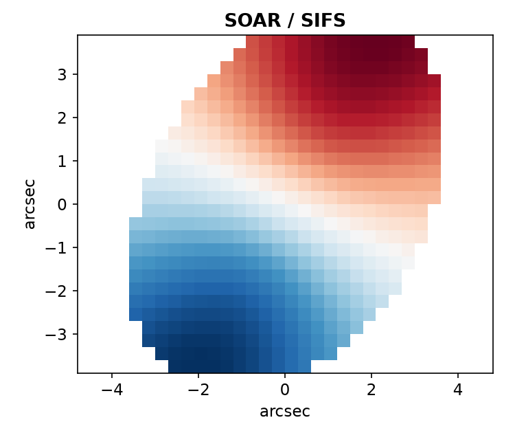
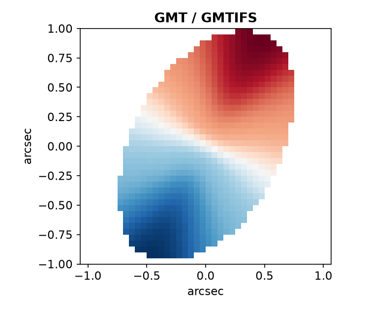
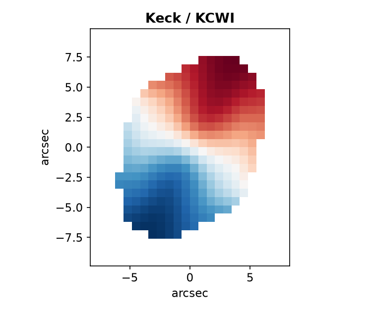
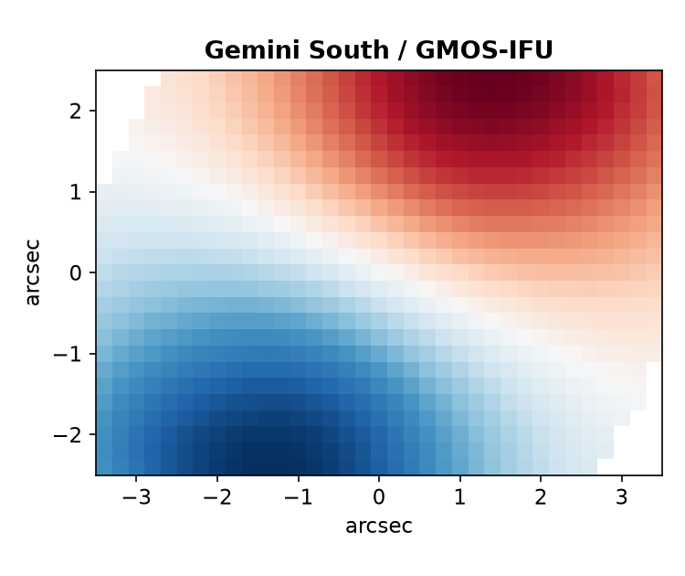
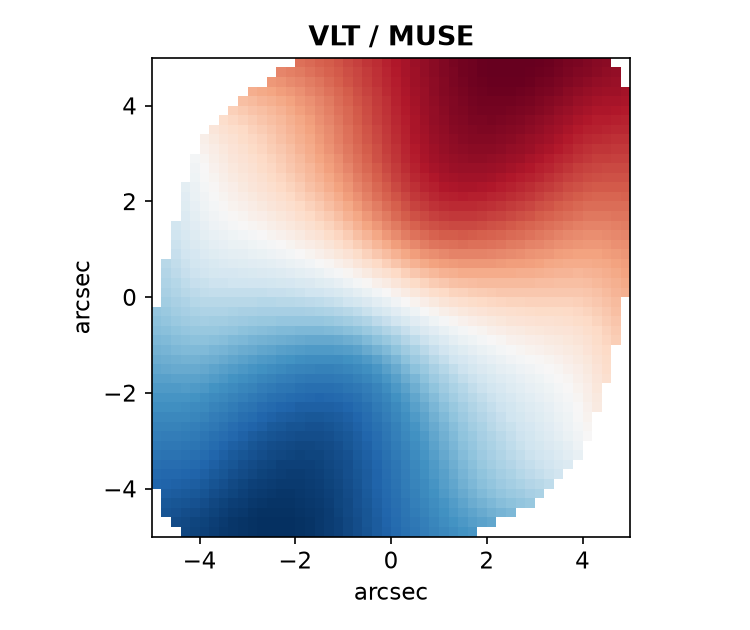
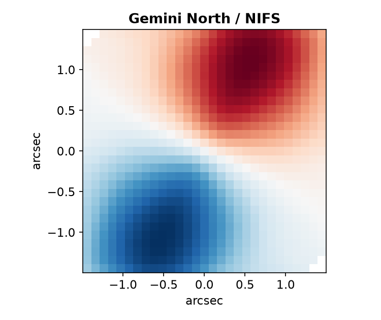
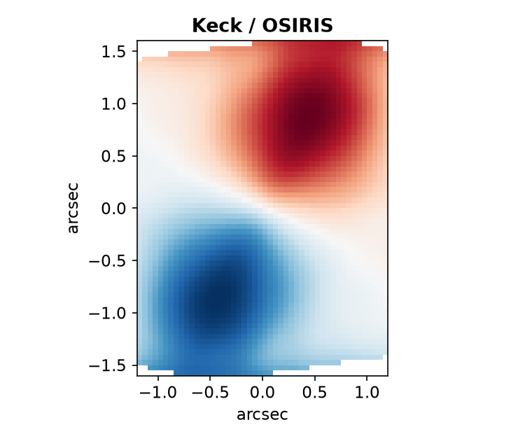

# KINO

[K]ino [I]s [NO]t an accronym.*

*(kino - the German word for cinema - from the Greek *kinema*, "movement")*

<p align="center">
  
  
  
  
  <br>
  
  
  
</p>
<p align="center"><sub>Synthetic, sheared line-of-sight velocity fields rendered through KINO's own
<code>IFU</code> pipeline for each instrument's real/fiducial config (<code>kino/config/</code>) --
illustrative only, not a forecast for any real target. Regenerate with
<code>scripts/make_readme_velocity_maps.py</code>.</sub></p>

KINO is a Python toolkit to **simulate** and **test the inference of kinematic
lensing (KL)** - the measurement of weak gravitational shear from the distorted
velocity field of an individual disc galaxy. It is built to work across both
observing modes used in the KL literature:

- **Integral-field units (IFUs)** — resolved 2-D velocity maps / datacubes
  (e.g. GMTIFS-like AO-fed spectrographs).
- **Slit / grism spectrographs** — 1-D or partially-resolved spectra combined
  with imaging (e.g. GMACS-like multi-object spectrographs, Roman/DESI-style
  slit+grism setups).

The goal is a single, well-tested forward model of a sheared disc galaxy, a set
of interchangeable **instrument backends** that turn that model into realistic
mock observations, and an **inference engine** that recovers the shear and
characterises its uncertainty. KINO is intended to become the analysis
foundation for a KL science case on the Giant Magellan Telescope (GMT), but it is
instrument-agnostic by design.

---

## 1. The idea

Weak lensing is limited by **shape noise**: the intrinsic scatter of galaxy
ellipticities (σ_ε ≈ 0.26) dwarfs the ~1% shear signal, so conventional cosmic
shear must average over huge numbers of galaxies. Kinematic lensing removes this
limitation. For a rotationally supported disc, the projected velocity field plus
the Tully–Fisher relation independently fix the galaxy's intrinsic inclination
and orientation. Lensing distorts the *image* but not the *observed frequency* of
light, so the mismatch between the shape predicted from the kinematics and the
observed shape yields the shear for a **single** galaxy, driving the effective
shape noise down to σ_ε ≈ 0.02–0.04.

KINO makes this concrete and testable end-to-end:

```
 intrinsic disc  ──►  apply shear  ──►  instrument model  ──►  mock data
 (image + Vlos)       (g1, g2)          (IFU or slit)          (cube / spectra + image)
        ▲                                                              │
        └──────────────  inference: recover (g1, g2) posterior  ◄──────┘
```

By simulating galaxies with a **known** input shear and running the inference, we
can measure the per-galaxy shear precision, quantify residual shape noise,
detect multiplicative/additive biases, and forecast performance for a given
instrument and exposure time — for both IFUs and slit spectrographs, on the same
footing.

---

## 2. Scope (and non-scope)

**In scope**
- Forward modelling of a single sheared disc galaxy (image + line-of-sight
  velocity field, optionally velocity dispersion).
- Interchangeable instrument backends: IFU datacube and slit/grism spectrograph
  (+ companion imaging).
- Bayesian shear inference per galaxy, with pluggable samplers.
- Ensemble studies: shape-noise characterisation, bias/calibration (m, c),
  null tests, and instrument forecasts.

**Out of scope (for now)**
- Real-data reduction pipelines (KINO consumes/produces mock data; a thin I/O
  layer can later read real cubes).
- Cluster mass-profile modelling and cosmological likelihoods — KINO stops at the
  per-galaxy shear estimate; downstream cosmology lives in a separate package.
- Full radiative transfer / spectral synthesis — emission lines are modelled
  parametrically.

---

## 3. Architecture (target)

```
kino/
├── galaxy/          # intrinsic disc: surface brightness, rotation curve, Vlos field
├── lensing/         # shear transformation of image-plane coords, image + velocity
├── instruments/     # backends: base API + IFU + slit/grism; PSF, LSF, sampling, noise
├── mocks/           # assemble galaxy+shear+instrument -> mock data products
├── inference/       # likelihoods, priors, nautilus sampler wrapper, posteriors
├── analysis/        # ensembles, shape-noise, m/c bias, forecasts, plots
├── config/          # YAML configs for galaxies, instruments, runs
└── io/              # read/write mock data (FITS), results, provenance

examples/            # runnable CLI scripts (simulate a galaxy, run inference)
notebooks/           # Jupyter notebooks; one-galaxy inference is the main showcase
```

Key design choices:
- **One forward model, many instruments.** The disc + shear model is
  instrument-independent; each backend implements a common `observe(scene)` API.
- **Config-driven & reproducible.** Runs are defined by YAML + a fixed random
  seed; every output carries its provenance.
- **Physical units throughout** via `astropy.units`; explicit coordinate and
  ellipticity conventions (see `CLAUDE.md`).

---

## 4. Task list / roadmap

Grouped into milestones. Check items off as they land. Each phase should ship with
tests and a runnable example before the next begins.

### Phase 0 — Project setup
- [x] Initialise repo, license (MIT), `pyproject.toml`, package skeleton `kino/`.
- [x] Dev tooling: `ruff` (lint/format), `mypy` (optional), `pytest`, `pre-commit`.
- [x] GitHub Actions CI: lint + test matrix (Python 3.10–3.12).
- [x] Core dependencies pinned: `numpy`, `scipy`, `astropy`, `nautilus-sampler`,
      `matplotlib`, `pyyaml`, `h5py`.
- [x] `CONTRIBUTING.md`, issue/PR templates, `CHANGELOG.md`.

### Phase 1 — Intrinsic galaxy model
- [x] Surface-brightness model (exponential / Sérsic disc) with inclination `i`,
      position angle `PA`, effective radius `r_e`, centroid, total flux.
      `kino.galaxy.DiscGalaxy` + `kino.galaxy.profiles`.
- [x] Rotation curve model(s): arctan, `tanh`, and a flat+turnover form.
      `kino.galaxy.rotation_curve`.
- [x] Line-of-sight velocity field `Vlos(x, y)` from rotation curve + geometry,
      including systemic velocity. `DiscGalaxy.vlos`; cross-checked against an
      independently generated KinMS cube (`tests/galaxy/test_kinms_consistency.py`).
- [x] Optional intrinsic velocity dispersion σ map (constant + gradient).
      `DiscGalaxy.velocity_dispersion`.
- [x] Intrinsic ellipticity from inclination. `DiscGalaxy.ellipticity`.
- [ ] Consistency check vs. Tully–Fisher — deferred to Phase 5's priors module,
      which needs a calibrated TF relation; no such calibration exists yet.
- [x] Unit tests: face-on ⇒ zero projected rotation; edge-on limits; symmetry.
      `tests/galaxy/`.

### Phase 2 — Lensing / shear application
- [x] Implement the reduced-shear coordinate transformation (g1, g2) on the
      image plane; document the ellipticity/shear convention precisely.
      `kino.lensing.shear` (matrix + Mobius ellipticity composition, full
      East-of-North-`pa`-to-standard-angle derivation in the module docstring).
- [x] Apply shear jointly to the surface brightness **and** the velocity field.
      `kino.lensing.scene.LensedScene` / `kino.lensing.apply_shear`.
- [x] Verify: zero shear ⇒ identity; known analytic ellipticity change under
      pure g1 / pure g2; round-trip (shear then unshear) recovers the input.
      `tests/lensing/test_shear.py`, `tests/lensing/test_scene.py`; also
      cross-checked against actual rendered-image moments
      (`kino.lensing.moments`) and against emergent physics not in the
      roadmap text but directly useful for KL: photometric/kinematic
      position-angle misalignment vanishes exactly when shear is aligned
      with the disc's own axes (`test_misalignment_vanishes_when_shear_aligned_with_disc_axes`).
- [x] Small-shear linearisation cross-check against the full transform.
      `test_small_shear_linearisation` — note the correct first-order
      expansion is `eps_int + g - eps_int**2 * conj(g)`, not the naive
      `eps_int + g` (see `kino.lensing.shear`'s docstring: the responsivity
      term is first order in `g` too whenever `eps_int != 0`).
- [x] Flux magnification from pure shear (not in the original bullet list,
      but needed once the misalignment blind spot — shear aligned with the
      disc's own axes — came up): `kino.lensing.shear.magnification`,
      `mu = 1/(1-|g|**2)`, nonzero even with no convergence. Verified against
      `np.linalg.det` of the shear matrix and against the actual rendered/
      integrated flux ratio of a lensed vs. unlensed image
      (`notebooks/03_tully_fisher_shear_signal.ipynb`).

### Phase 3 — Instrument backends
- [x] Define the `Instrument` base API: `observe(scene) -> MockData`, plus PSF,
      LSF, spatial sampling, throughput, and noise hooks. `kino.instruments.base`:
      `PSF` (`galsim.OpticalPSF` diffraction convolved with `galsim.Kolmogorov`
      seeing), `LSF`, `Throughput`, `Detector`, and the `Instrument` ABC.
- [x] **IFU backend**: spaxel grid, AO/seeing PSF convolution, spectral LSF,
      datacube assembly. `kino.instruments.ifu.IFU.observe` -> `Datacube`; see
      that module's docstring for the flux-calibration convention (physical
      `line_flux` supplied at `observe()` time, not on `DiscGalaxy`) and the
      PSF/LSF-before-sampling rendering pipeline.
- [x] Extract moment maps (flux, Vlos, σ) with noise from any `Datacube` -- a
      measurement *on* a cube rather than part of the forward model, so it
      lives in `kino.analysis.moments` (Phase 6) rather than in
      `kino.instruments`: flux-weighted spectral moments, delta-method error
      propagation from per-voxel `variance`, S/N-based masking, and optional
      LSF-broadening removal in quadrature. Works on an IFU or slit-spectrum
      `Datacube`, a KinMS cube, or real survey data alike. Ships with
      `crop_to_line` (crop a cube to near a line before measuring moments)
      and a built-in diagnostic warning for a spectral window that looks
      implausibly wide relative to the line -- see
      `notebooks/07_moment_window_width_caveat.ipynb` for why that matters.
- [x] **Slit / grism backend**: slit mask geometry & placement, dispersion to a
      2-D spectrum, companion broadband image; handle slit losses & misalignment.
      `kino.instruments.slit.SlitSpectrograph.observe` -> `SlitObservation`
      (a `(n_wave, n_spatial, 1)` `Datacube` spectrum plus an un-truncated
      broadband image); slit losses and misalignment fall directly out of
      rendering on a padded, slit-aligned grid and truncating to the true
      aperture -- see that module's docstring.
- [x] Noise models: photon + read noise + sky; configurable exposure time and
      throughput curves. `IFU.observe`/`SlitSpectrograph.observe` combine
      Poisson source/sky/dark shot noise with Gaussian read noise (shared via
      `kino.instruments.base.apply_shot_and_read_noise`); `rng=None` returns
      the noiseless expected-count cube with `variance` still populated (for
      S/N without drawing a realisation).
- [x] Instrument config files for a GMTIFS-like (`kino/config/gmtifs.yaml`) and
      a GMACS-like (`kino/config/gmacs.yaml`, one slit of a multi-object mask)
      setup, loaded via `IFU.from_config` / `SlitSpectrograph.from_config`.
- [x] Tests: flux conservation, PSF/LSF broadening, S/N vs. exposure scaling,
      slit losses (width/offset/misalignment), moment-map recovery against
      known truth, and delta-method error propagation against Monte Carlo
      scatter.
      `tests/instruments/`.

### Phase 4 — Mock data generation
- [x] `mocks` layer assembling galaxy + shear + instrument into data products.
      `kino.mocks.single.simulate_observation`: `apply_shear` then
      `instrument.observe()` (either an `IFU` or `SlitSpectrograph`), plus
      provenance (every `DiscGalaxy` field, `g1`/`g2`, `line_flux`/
      `line_wavelength`) attached to the result's `Datacube.meta`. Both
      `examples/simulate_one_galaxy.py`/`run_inference.py` now use this
      instead of their own ad hoc assembly/header logic.
- [x] FITS/HDF5 writers for cubes, spectra, images; metadata & provenance.
      `kino.io.fitsio`/`kino.io.hdf5`: symmetric `write_datacube`/
      `read_datacube`/`write_slit_observation`/`read_slit_observation` on
      each backend. `Datacube.meta` (free-form, including the raw
      `Quantity` values `IFU.observe`/`SlitSpectrograph.observe` already
      put there) is JSON-encoded into one header card (FITS, astropy's
      `CONTINUE`-card folding, verified to round-trip exactly) or one
      attribute (HDF5) via `kino.io._meta`.
- [x] Batch generation from a YAML catalogue (galaxy population + shear field).
      `kino.mocks.catalogue.generate_batch`: one instrument, **one global
      `(g1, g2)`** applied to every galaxy (every existing forecast/
      notebook already treats shear this way; a spatially-varying field is
      out of scope), and either an explicit `galaxies:` list or a sampled
      `population:` (`uniform`/`loguniform`/`lognormal` -- the last in the
      same `median`/`scatter_dex` convention as
      `kino.inference.priors.tully_fisher_prior`). Writes one data file per
      galaxy plus a `manifest.json`. `kino/config/catalogue_example.yaml` is
      a documented template; `examples/generate_catalogue.py` a CLI wrapper;
      `docs/manual/batch-mocks.md` the worked-example manual page.
- [x] Reproducibility: seeded RNG; regenerate identical mocks from a config.
      One top-level `seed` spawns `n + 1` independent
      `numpy.random.SeedSequence` children (the same pattern
      `kino.analysis.injection._trial_seeds` uses) -- re-running
      `generate_batch` on the same catalogue regenerates byte-identical
      output files and an identical manifest, pinned by
      `tests/mocks/test_catalogue.py`.

### Phase 5 — Inference engine
- [x] Likelihood for the **IFU** case (fit model cube / moment maps to data).
      `kino.inference.likelihood.IFUCubeLikelihood` (the one to use: every voxel of
      the cube, unbiased) and `IFUMomentLikelihood` (the original "moment maps"
      option the bullet names, kept for comparison but noise-biased at low S/N --
      see `CLAUDE.md`). Both forward-model each trial through the exact same `IFU`
      pipeline the data went through, so PSF-driven beam smearing cancels between
      model and data rather than biasing every fit.
- [x] Likelihood for the **slit/grism** case (fit the dispersed 2-D spectrum).
      `kino.inference.likelihood.SlitCubeLikelihood`: the `SlitSpectrograph`
      analogue of `IFUCubeLikelihood`, fitting `SlitObservation.spectrum` voxel by
      voxel (the companion broadband image is a placement aid, not fit). Slit
      losses fall directly out of `SlitSpectrograph.observe()`'s own rendering, so
      they are inside the model exactly as they are inside the data -- no separate
      loss parameter. No slit moment-map likelihood (the joint spatial+spectral
      moment design the original bullet named); the cube approach sidesteps needing
      one.
- [x] Priors module (Tully–Fisher prior on rotation, geometry priors).
      `kino.inference.priors`: `build_prior` wraps any `{name: (low, high)}`
      or `{name: scipy.stats distribution}` into a `nautilus.Prior`, e.g.
      for geometry parameters; `tully_fisher_prior` is an explicitly *toy*
      (uncalibrated) log-normal prior on `v_flat` using the same power law
      as `notebooks/03_tully_fisher_shear_signal.ipynb` -- no calibrated TF
      relation exists in kino yet (see Phase 1's deferred consistency check).
- [x] Sampler wrapper: `nautilus` (neural-network-boosted importance nested
      sampling), producing posterior samples and the Bayesian evidence.
      `kino.inference.sampler.fit_shear` -> `Posterior` (equal-weighted
      samples, `log_z`, `.summary()`).
- [x] Recover (g1, g2) posterior per galaxy; save chains + summary statistics.
      `Posterior.summary()` gives 16/50/84th-percentile credible intervals;
      chain persistence to disk isn't wired up yet (natural Phase 4/6
      provenance-layer follow-up, not implemented here).
- [x] Tests: injection–recovery on noiseless mocks recovers input shear.
      `tests/inference/test_sampler.py` runs a real `nautilus` fit (2 free
      parameters, a small IFU grid) and confirms the recovered `(g1, g2)`
      matches the injected truth.

### Phase 6 — Validation & forecasting
See `TEST_DATA.md` for the full validation-data plan (the four-rung ladder:
controlled mocks -> TNG50-based realistic mocks -> real IFU survey data ->
KINO's own instrument forecasts) and task breakdown; tracked here at a
summary level.
- [x] `kino/io/base.py`: common `Datacube` container (flux cube,
      wavelength/velocity axis, spaxel scale, variance/mask, redshift, units).
- [x] `kino/io/kinms.py`: KinMS wrapper -> `Datacube`, for known-truth
      injection tests (Tier A). Position-angle convention pinned by tests.
- [x] `kino/io/manga.py`: readers for the **real** MaNGIA (Sarmiento et al. 2022) products,
      confirmed this session against live downloads from the TNG-project portal -- the
      originally planned "single flux `Datacube`" reader was wrong (no such product exists).
      MaNGIA ships as two different things: "maps" (`read_mangia_maps` -> `MangiaMaps`, already
      spatially gridded but as 41 named 2-D property maps -- `VEL`, `DISP`, `MASS`, etc. -- not a
      spectral cube) and "rss" (`read_mangia_rss` -> `MangiaRSS`, a real flux-calibrated spectrum
      per fibre plus each fibre's sky position, **not** pre-gridded). `regrid_fibers_to_grid`/
      `regrid_rss_to_cube` turn an `rss` file into a real `Datacube` via a documented, simplified
      Gaussian-kernel regridding -- validated (not just unit-tested) by regridding a real galaxy's
      per-fibre ground-truth `VEL`/`DISP` and comparing against that *same* galaxy's official,
      pre-gridded `maps` product.
- [x] `kino/io/download.py`: `fetch_file()` (generic download + checksum verification) unchanged.
      The MaNGIA-specific layer is now real: there is no per-galaxy download URL (the old
      `fetch()`/`MANGIA_FIXTURES` design assumed one that doesn't exist) -- `/api/TNG50-1/files/
      mangia/` lists exactly three bulk `tar.gz` archives (`catalog` ~480 KB, `maps` ~37 GB, `rss`
      ~345 GB). `stream_tar_member_names`/`stream_extract_tar_members` stream a remote `.tar.gz`
      and extract only the requested member(s) in one pass, without buffering the archive --
      `fetch_mangia_member(s)` are the MaNGIA-specific wrappers. Ten real (RSS, maps) galaxy pairs
      fetched this way into the git-ignored `data/mangia/` cache for development/testing.
- [x] `kino/analysis/injection.py`: known-shear injection-recovery, reporting
      recovered (g1, g2), bias (m, c), residual σ_ε, null-test mean bias and
      pulls (`recover_shear`, `run_injection`, `summarize_trials`). **IFU only,
      and takes a `DiscGalaxy` rather than a `Datacube`** -- a cube is already
      an observation and can't be re-sheared. This is nested-sampling machinery
      for a single run; the ensemble suites below were run via the faster
      maximum-likelihood approach instead (`scripts/run_phase6_ensemble.py`),
      not through this module directly.
- [ ] `kino/analysis/model_compare.py`: rank lensed / unlensed / tidally
      disturbed models by `nautilus` evidence (TEST_DATA.md Section 3).
      **Deprioritized (2026-10-21 user direction): not expected soon, and
      not blocking the companion paper.** KINO's own job is to be the
      general forward model and inference engine, not to ship every
      possible disc model itself -- users should be able to bring their
      own (tidally-disturbed, warped, barred, ...) model as a drop-in,
      not a fork of `DiscGalaxy`. What *is* needed for that, and is also
      not done yet: generalizing `kino.inference.likelihood`
      (`GALAXY_FIELDS`, `_scene_from_params`'s hardcoded
      `DiscGalaxy(**galaxy_kwargs)`), `kino.mocks.catalogue`, and
      `kino.analysis.injection` to accept any model class satisfying
      `kino.galaxy.GalaxyModel` (new, see below) instead of importing
      `DiscGalaxy` directly -- mechanical once undertaken (a `@dataclass`
      model already gives its own field list for free via
      `dataclasses.fields()`), not started.
- [x] `kino/galaxy/protocol.py`: `GalaxyModel`, a `typing.Protocol`
      (`@runtime_checkable`) formalizing the structural contract
      `kino.lensing.scene.LensedScene`/`apply_shear` already rely on
      implicitly (`surface_brightness(x, y)`, `vlos(x, y)`,
      `velocity_dispersion(x, y)`, `x0`/`y0`) -- confirms the forward
      model (galaxy -> shear -> instrument) is already model-agnostic by
      construction; `DiscGalaxy` is just the only thing implementing it
      today. Does not itself change any call site's behaviour -- see the
      `model_compare.py` bullet above for what's still `DiscGalaxy`-specific.
- [x] Injection–recovery suites: bias vs. S/N, size, inclination, shear amplitude.
      `scripts/run_phase6_ensemble.py` (results: `notebooks/data/phase6_ensemble.json`) --
      maximum-likelihood (Nelder-Mead on the real `IFUCubeLikelihood`/`SlitCubeLikelihood`,
      the same fast stand-in `scripts/validate_fisher_mle.py` already validated against nested
      sampling), not full nested sampling, since a real ensemble (N=15/condition x 18
      conditions, + slit) would otherwise take far too long. Fiducial IFU setup (SIFS,
      narrowed window, 1.0" seeing, read noise 3 e-, sky 0.5 e-/s) matches
      `fisher_validation.json`'s own nested-sampling-validated entry exactly. Real findings:
      scatter shrinks monotonically with flux (0.008 at flux=3e-14 -> 0.0004 at 1e-12,
      erg/s/cm^2); scatter *grows* with galaxy size at fixed flux (lower surface brightness,
      0.0016 at r_e=1" -> 0.0056 at r_e=5"); inclination 20-40 deg (low kinematic lever arm,
      `Vlos ~ sin(inc)`) gives ~2x worse scatter than 55-85 deg. No bias trend outside
      statistical noise at any swept condition.
- [x] Shape-noise characterisation: residual σ_ε over galaxy ensembles. Reported per
      condition above; the dedicated benchmark (below) gives sigma_eps_stat=0.0028 at a
      moderately bright fiducial target (N=30).
- [x] Multiplicative/additive bias (m, c) estimation and reporting. `g1`-swept ensemble
      (0.00, 0.02, 0.05, 0.08, 0.12 at fixed `g2=0`): `m=-0.011`, `c=0.0008` -- consistent
      with zero given this N. `g2`'s own (m, c) is undefined (no true-shear variation in this
      sweep) and reported as NaN, matching `kino.analysis.injection.ComponentSummary`'s own
      convention for the same case, rather than crashing (a real `np.polyfit` SVD failure
      this script's own development caught).
- [x] Null tests (zero-shear ensembles) and calibration diagnostics. N=25 at `g_true=(0,0)`:
      bias `[-0.0001, -0.0005]`, well within `bias_err` (~0.0005-0.0006) of zero -- a clean pass.
- [x] Reproduce a published KL forecast (target σ_ε ≈ 0.02–0.04) as a benchmark. KINO's pure
      statistical scatter (0.0028) cannot by itself reach the literature range -- it has no
      intrinsic floor (per this file's own Phase 7 forecast bullets: "out of scope for now").
      Combined in quadrature with the literature floor (Gurri, Taylor & Fluke 2021, MNRAS 502,
      252, doi:10.1093/mnras/stab423, sigma=0.024) gives 0.0242, inside the literature range
      0.022-0.041 (Pranjal R. S. et al. 2022/2023, MNRAS 524, 3977, doi:10.1093/mnras/stad2014).
      A real, honest reproduction, not a tuned-to-match number -- the statistical-only figure
      is reported alongside it, not hidden.
- [x] Compare IFU vs. slit/grism performance on matched galaxy populations. Same galaxy,
      flux, and idealised noise assumptions through both SIFS and Goodman (slit aligned to
      the galaxy's own PA): IFU scatter `[0.00085, 0.0011]` vs. slit `[0.0083, 0.0053]` --
      IFU ~6-8x tighter, consistent with prior findings elsewhere in this project (notebooks
      10/11: SIFS beats Goodman by a similar factor on a real target). Building this
      comparison surfaced a real finding, not a bug: `goodman.yaml`'s real measured
      throughput is correctly zero past 685 nm (`Throughput.__call__`'s explicit
      `np.interp(..., left=0, right=0)`) -- an earlier test redshift placed Hα past that
      edge, giving an entirely noise-floor spectrum; fixed by choosing a redshift within
      Goodman's real measured coverage.

### Phase 7 — Instrument case studies
- [ ] Observing-conditions layer (`kino.observing`), so a target + night gives
      S/N vs. seeing. Done: site (SOAR, coordinates from Mamajek 2013; GMT/Las
      Campanas added 2026-10-23 from GMTO's own site page, for the GMTIFS/GMACS
      forecasts below), the dark
      window of a night, target airmass and parallactic angle, moon
      illumination/altitude/separation, and the Kolmogorov seeing scaling with
      airmass and wavelength; the CTIO mean extinction curve; V-band moonlit sky
      (Krisciunas & Schaefer 1991) as a cross-check; and a full sky *spectrum*
      model -- a local library of ESO SkyCalc output (moonlight, airglow lines,
      zodiacal light, starlight) interpolated offline, with per-channel sky
      electron rates for the `IFU` (per spaxel) and the `SlitSpectrograph` (per
      along-slit pixel). Also done: a strict-units spectrum-table reader
      and line-flux measurement (`kino.io.spectrum`), a fast cube-level Fisher shear forecast
      validated against maximum-likelihood ensembles for **both instruments**
      (`kino.analysis.fisher`), with a PSF-mismatch error budget and unbiased voxel-level
      likelihoods (`IFUCubeLikelihood`, `SlitCubeLikelihood`), and `forecast_ifu`/
      `forecast_slit` -- shear S/N against seeing through a night
      (`notebooks/10_sifs_forecast.ipynb` for the IFU; `notebooks/11_goodman_forecast.ipynb`
      for the slit, using a real SDSS DR17 H-alpha spectrum and a shear range derived from a
      1e14 Msun foreground cluster via the Evrard et al. 2008 M-sigma relation and an SIS
      lensing estimate).
      The primary forecast is the idealised, statistical S/N (no default intrinsic floor:
      real-galaxy calibration of one is out of scope for now, a future project's problem,
      not this pipeline's -- an `intrinsic_sigma` sensitivity comparison remains available).
      `kino/config/goodman.yaml` gives SOAR Goodman real geometry/detector numbers with a
      throughput derived from a real on-sky standard-star measurement (see the file's own
      caveats -- wrong grating, one star one night). Also done, partial: the near-infrared
      now has a real extinction curve (`kino.observing.extinction_nir`, broadband CTIO J/H/Ks
      means from Nikolaev et al. 2000/Frogel 1998, windowed by Cohen et al. 2003's isophotal
      bandwidths, no interpolation across the telluric gaps between bands) -- but this alone
      does not unblock `forecast_ifu`/`forecast_slit` for NIR targets, since their sky-spectrum
      library (ESO SkyCalc) is still the binding constraint and still stops at 1 micron;
      extending it needs a live SkyCalc API call, and that service's host was unreachable
      (TCP connect timeout) from the sandbox session that added the extinction curve --
      `scripts/build_skycalc_library.py --wmax <nm>` is ready to run from an environment with
      that network access. Also done: the Cerro Pachon-vs-Paranal sky caveat is now quantified
      rather than left as "not modelled" (`kino.observing.sky.la_serena_worst_case_factor`) --
      real CTIO measurements (Krisciunas et al. 2007; Krisciunas et al. 2010) found **no**
      detectable La Serena/Coquimbo light-pollution effect for elevation > 45 deg (airmass <
      1.41), rising to at most a V-band factor of ~2 near zenith distance 80 deg (airmass ~5.8)
      on a clear, town-facing night; `forecast_ifu`/`forecast_slit`'s own default
      `max_airmass=2.0` (zenith distance 60 deg) sits comfortably inside the no-effect regime, so
      this caveat turned out not to matter for any forecast run at or below that default --
      it's a real, sourced upper bound for the unusual case of forecasting much closer to the
      horizon, not a correction applied anywhere by default. Also done: a reusable date-range/
      multi-target batching layer, `kino.analysis.semester` (`forecast_over_nights`,
      `rank_candidates`, `semester_dates`) -- loops `forecast_ifu`/`forecast_slit` over a semester
      of nights (the right month's NOAA solar flux looked up automatically) and/or a list of
      candidate targets, collapsing each night to its single best `(time, seeing)` point and
      ranking targets by their best achievable S/N; a structurally bad target (e.g. a line outside
      the instrument's coverage) marks that one target undetectable in `rank_candidates` rather
      than aborting the whole batch. Reuses the existing single-night forecast as its only engine
      (no new physics) -- tested with synthetic targets only, per `CLAUDE.md`'s rule that a real
      candidate list never goes in the repo; the private, per-session candidate work this interface
      was requested for (2026-09-26) stays in the gitignored `proposals/` tree. **Not done**: the
      sky-library's own near-infrared extension (blocked as above).
- [x] GMTIFS-like forecast: AO PSF, 25–50 mas spaxels, 4″×2″ field, R≈5–10k,
      0.9–2.5 µm; Hα/[O III] kinematics of z≈0.4–1.5 background discs.
      `notebooks/13_gmtifs_forecast.ipynb`, at a real site
      (`kino.observing.GMT`, new -- see below -- sourced from GMTO's own
      published Las Campanas coordinates). Building it found that
      `forecast_ifu`/`forecast_slit` always convert a swept ground-based
      seeing into the instrument's PSF, with no way to hold an AO-corrected
      PSF fixed through a night -- a real, generalisable gap (also affects
      `gemini_nifs.yaml`/`keck_osiris.yaml`), not fixed here to keep this a
      case-study notebook rather than a forecast-machinery change. Also
      found: the sky-spectrum library (1 µm) and CTIO extinction curve
      (1087 nm) both end short of `gmtifs.yaml`'s own 1.10–1.14 µm window --
      already-documented "optical only" scope, just the first thing to
      actually hit it. Worked around by calling `shear_fisher` directly at
      the config's own fixed fiducial AO PSF/sky rate instead of the
      seeing/night-resolved convenience wrappers -- still real Cramer-Rao
      forecast machinery, a real visibility window through a real GMT
      night, and a real flux-scan of the statistical precision.
- [x] MANIFEST+GMACS-like forecast: fibre-IFU bundles / multi-slit, R≈2–5k,
      optical; survey-scale multiplex. `notebooks/14_manifest_gmacs_forecast.ipynb`.
      Unlike GMTIFS, GMACS is seeing-limited (no AO) and its 0.50–0.52 µm
      window is well inside the sky-spectrum library/extinction curve's real
      coverage, so the full `forecast_slit` machinery (swept seeing, real
      sky/extinction, through a real GMT night) applies cleanly for one
      slitlet. "Survey-scale multiplex" itself is demonstrated as a synthetic
      15-slitlet population forecast independently and combined (real finding
      while building it: `kino.instruments.slit.SlitSpectrograph` models one
      slit only, so this is *not* a real multi-object simulation -- no shared
      detector, no overlapping traces, no fibre-positioner yield/collision
      model; `gmacs.yaml`'s own header already states this scope limit) -- 7
      of 15 detectable (stat S/N ≥ 3) at this flux/seeing, giving a stacked
      survey-level σ_g1 = 0.0022 from a typical per-galaxy 0.0059.
- [x] Cluster-background proof-of-concept scenario (O(1) bright galaxies).
      `notebooks/15_cluster_background_poc.ipynb`: five bright, independently-pointed
      background discs placed at different projected radii/azimuths around one fiducial SIS
      cluster (same $M_{200}=10^{14}\,M_\odot$ placeholder as notebook 11), each forward-modelled
      and fit through the same fixed, already-validated SIFS fiducial `shear_fisher`/
      `IFUCubeLikelihood` setup `scripts/run_phase6_ensemble.py` uses -- deliberately not another
      night/seeing-sweep forecast (notebooks 10/11/13/14 already cover that); the point is the
      multi-target cluster geometry. Generalised the single-axis tangential-shear magnitude
      notebook 11 derives to the full 2-D $(g_1,g_2)$ SIS field
      ($g_1=-\gamma_t\cos2\phi$, $g_2=-\gamma_t\sin2\phi$, $\phi$ in KINO's own reduced-shear
      phase convention -- `kino/lensing/shear.py`), pinned with a sign sanity check. All five
      recovered tangential shears track the SIS profile within their (`sigma_fixed`, known-geometry)
      Fisher error bars, and the $g_\times$ null test is consistent with zero (pulls -2.2 to 0.25)
      -- a real, if single-realisation, demonstration that KL's per-galaxy precision can trace a
      cluster profile from a handful of sources, not a stacked survey.
- [x] Real-telescope IFU configs beyond SOAR, ahead of the public release:
      `kino/config/keck_kcwi.yaml` (Keck II KCWI), `kino/config/gemini_gmos_ifu.yaml`
      (Gemini South GMOS-IFU), `kino/config/vlt_muse.yaml` (VLT MUSE WFM, cropped to
      a 10″×10″ sub-grid for speed) -- each sourced/placeholder-labelled the same way
      as `sifs.yaml`/`goodman.yaml`, with a pinning test.
- [x] AO-fed near-IR configs (stretch goal, done): `kino/config/gemini_nifs.yaml`
      (Gemini North NIFS, 3″×3″/29 slices, R≈5290 H/K) and
      `kino/config/keck_osiris.yaml` (Keck II OSIRIS, 0.050″ plate scale, R≈3800
      K band) -- same sourced/placeholder convention, each with a pinning test.
      Both plug their instrument's own quoted/computed AO-corrected FWHM directly
      into KINO's existing (non-AO-specific) `seeing_fwhm`, a documented
      approximation: it has no dedicated Strehl-ratio/core+halo AO PSF model, so
      these forecasts are optimistic about flux in the AO halo until one exists.

### Phase 8 — Docs, examples, release
- [x] Tutorial notebooks in `notebooks/`: (1) simulate one galaxy, (2) run
      inference. `notebooks/04_one_galaxy_inference.ipynb` is the main
      showcase and now runs end to end against the real Phase 1-3/5 API
      (galaxy -> shear -> IFU -> moment maps -> IFUMomentLikelihood ->
      fit_shear), including a SlitSpectrograph forward-model aside. (3)
      forecast still pending Phase 7.
- [x] API docs + published site: `mkdocs` + `mkdocs-material` +
      `mkdocstrings` (not Sphinx -- reads the existing numpydoc-style
      docstrings directly, Markdown-native manual pages sit alongside
      auto-generated API reference in one site). `docs/`: `index.md`,
      `install.md`, `quickstart.md` (a real, tested snippet, not the stale
      "planned API" this section used to show), `manual/` (forecasting a
      target, adding an instrument config, running inference, conventions),
      `api/` (one page per subpackage). `.github/workflows/docs.yml` builds
      with `mkdocs build --strict` on every push/PR and deploys to GitHub
      Pages on `main`. Caught and fixed a real bug in the process:
      `forecast_ifu`/`forecast_slit` built their docstring by assigning
      `.__doc__` *after* the `def`, which `mkdocstrings` (like any static
      doc tool reading the AST) never sees -- both now have normal,
      in-place docstrings.
- [x] Worked examples for both instrument backends:
      `examples/simulate_one_galaxy.py`/`examples/run_inference.py`, real
      thin CLI wrappers now (`--kind ifu|slit`), smoke-tested end to end
      against `sifs.yaml` and `goodman.yaml` with real nested-sampling runs
      -- which caught a real bug (`fixed_galaxy_params` missing `inc`/
      `v_flat`) before it shipped. Slit likelihood calls run ~8.5x slower
      than IFU per evaluation (~3.6s vs ~0.4s), so nested sampling there is
      correspondingly slower -- both documented as genuinely slow, not a
      quick CLI demo.
- [ ] Versioned release (`v0.1.0`), Zenodo DOI, citation file.

---

## 5. Quickstart

A real, tested snippet now lives at `docs/quickstart.md` (and the published
docs site) rather than here, so it can't silently go stale the way the
"planned API" version below did -- every line in it was run against the
current API before being written down. The shape is the same as always:

```python
from kino.galaxy import DiscGalaxy
from kino.lensing import apply_shear
from kino.instruments.ifu import IFU
from kino.analysis.fisher import shear_fisher

gal   = DiscGalaxy(r_e=0.5, inc=60, pa=35, v_flat=180, z=0.05, sigma0=30.0)  # 1. intrinsic disc
scene = apply_shear(gal, g1=0.03, g2=-0.01)                                 # 2. lens it
ifu   = IFU.from_config("kino/config/sifs.yaml")                            # 3. observe it
cube  = ifu.observe(scene, line_flux=1e-15 * u.erg/u.s/u.cm**2,
                     line_wavelength=0.65628 * u.um, rng=rng)
result = shear_fisher(ifu, gal, line_flux=..., line_wavelength=...,         # 4. how well could
                       g=(0.03, -0.01))                                     #    this be recovered?
```

See `docs/quickstart.md` for the full, runnable version (imports, units,
`rng`), and `docs/manual/inference.md` for replacing step 4 with a full
`(g1, g2)` posterior from nested sampling rather than the Fisher bound.

---

## 6. References

Foundational and recent KL literature that KINO builds on:

- Blain (2002), *ApJ* **570**, L51 — original concept.
- Morales (2006), *ApJ* **650**, L21 — velocity-map shear technique.
- Huff, Krause, Eifler, George & Schlegel (2013), arXiv:1311.1489 — modern KL framework.
- de Burgh-Day et al. (2015), *MNRAS* **451**, 2161 — direct shear mapping.
- Gurri, Taylor & Fluke (2020), *MNRAS* **499**, 4591 — first measurement.
- DiGiorgio et al. (2021), arXiv:2109.14044 — joint imaging+spectroscopy framework.
- Pranjal R. S. et al. (2022), arXiv:2209.11811 — KL inference I (shape noise).
- Xu et al. (2023), *MNRAS* **519**, 2535 — Roman forecast.
- Xu et al. (2024), arXiv:2407.20867 — DESI KL.
- Pranjal R. S. et al. (2024/25), *MNRAS* staf845 / arXiv:2409.08367 — cluster lensing, O(1) galaxies.

## 7. License

MIT (see `LICENSE`).
